# DOCUMENTAÇÃO TÉCNICA - BIODASH
## Relatório de Migração e Análise de Custos no Microsoft Azure

**Fatec Votorantim – Benedicto Pagliato**  
**Centro Paula Souza (CPS)**  
**Votorantim – SP | 2026**

---

### Autores / Integrantes:
* ALESSANDRO RODRIGUES – RA:
* ARIELE PERES – RA:
* DANIEL RODRIGUES – RA:
* GUILHERME PIVA – RA:
* MATHEUS GUEFF – RA:
* MAYARA BARROS – RA:
* TAÍSE RODRIGUES – RA:
* THIAGO MUNIZ E VANESSA CAPUANO

**BIODASH: Sistema de Gestão Operacional de Biodigestores.**  
Documentação técnica apresentada como requisito parcial de avaliação na disciplina de Projeto Integrador VI (PI-VI) do 6º semestre do curso em Desenvolvimento de Software Multiplataforma da Faculdade de Tecnologia de Votorantim.  
**Orientador:** Profº Cassio Ricardo

| Data de Elaboração | Versão |
| :---: | :---: |
| 24/10/2026 | V 1.0 – Documentação Técnica de Custos e Migração Azure |

---

## Sumário
1. [VISÃO GERAL DO PRODUTO](#1-visão-geral-do-produto)  
   1.1. [Contexto Operacional](#11-contexto-operacional)  
   1.2. [Diretrizes de Infraestrutura](#12-diretrizes-de-infraestrutura)  
2. [DESAFIOS DA MIGRAÇÃO](#2-desafios-da-migração)  
   2.1. [Mitigação do Cold Start no Azure Container Apps (Scale-to-Zero)](#21-mitigação-do-cold-start-no-azure-container-apps-scale-to-zero)  
   2.2. [Desacoplamento do Armazenamento de Arquivos (AWS S3 para Azure Blob Storage)](#22-desacoplamento-do-armazenamento-de-arquivos-aws-s3-para-azure-blob-storage)  
   2.3. [Isolamento e Segurança da Base Relacional (RDS para Flexible Server)](#23-isolamento-e-segurança-da-base-relacional-rds-para-flexible-server)  
   2.4. [Sanitização de Segredos em Pipelines Heterogêneos (Windows vs. Linux)](#24-sanitização-de-segredos-em-pipelines-heterogêneos-windows-vs-linux)  
   2.5. [Isolamento do Microsserviço de Inteligência Artificial](#25-isolamento-do-microsserviço-de-inteligência-artificial)  
   2.6. [Observabilidade com Padrões Abertos (OpenTelemetry e Azure Monitor)](#26-observabilidade-com-padrões-abertos-opentelemetry-e-azure-monitor)  
3. [EVIDÊNCIAS DE FUNCIONAMENTO E RESILIÊNCIA TÉCNICA](#3-evidências-de-funcionamento-e-resiliência-técnica)  
   3.1. [Testes de Cold Start e Latência Real](#31-testes-de-cold-start-e-latência-real)  
   3.2. [Probes de Liveness e Readiness](#32-probes-de-liveness-e-readiness)  
   3.3. [Comprovação Visual do Escalonamento a Zero em Produção](#33-comprovação-visual-do-escalonamento-a-zero-em-produção)  
   3.4. [Regras de Escalonamento Automático (KEDA HTTP Scaling Rules)](#34-regras-de-escalonamento-automático-keda-http-scaling-rules)  
4. [ANÁLISE DE CUSTOS NO MICROSOFT AZURE](#4-análise-de-custos-no-microsoft-azure)  
   4.1. [Visão Geral dos Custos no Azure](#41-visão-geral-dos-custos-no-azure)  
   4.2. [Evolução e Redução dos Custos ao Longo do Período](#42-evolução-e-redução-dos-custos-ao-longo-do-período)  
   4.3. [Auditoria do Consumo Residual Pós-Correção (14 a 23 de Outubro)](#43-auditoria-do-consumo-residual-pós-correção-14-a-23-de-outubro)  
   4.4. [Estrutura dos Resource Groups](#44-estrutura-dos-resource-groups)  
   4.5. [Eliminação de Custos Ocultos de Infraestrutura](#45-eliminação-de-custos-ocultos-de-infraestrutura)  
   4.6. [Projeção Operacional e Renovação de Cotas Gratuitas](#46-projeção-operacional-e-renovação-de-cotas-gratuitas)  

---

## 1. VISÃO GERAL DO PRODUTO

### 1.1. Contexto Operacional
O BioDash é uma plataforma conectada desenvolvida para a gestão e análise operacional de biodigestores rurais e industriais. O sistema consolida dados capturados por sensores telemétricos (temperatura, pressão de biogás, pH e vazão de efluentes), apresentando indicadores consolidados em painéis gráficos, sinalização preventiva de anomalias operacionais e assistente virtual inteligente baseado em linguagem natural.

O objetivo central da solução é viabilizar a tomada de decisão ágil e a redução de custos de manutenção corretiva no campo, preservando estabilidade, testabilidade e conformidade tecnológica contínua.

### 1.2. Diretrizes de Infraestrutura
O projeto estabeleceu como premissa a operação integral da infraestrutura no ecossistema Microsoft Azure sob a assinatura acadêmica *Azure for Students*. A arquitetura foi concebida para atender aos critérios de governança em nuvem:
* Provisionamento reproduzível via Infraestrutura como Código (IaC) com Microsoft Bicep.
* Desacoplamento arquitetural por meio de portas e adaptadores (Arquitetura Hexagonal).
* Autenticação segura e federada via OIDC (OpenID Connect) com GitHub Actions, eliminando o uso de chaves e segredos estáticos de longa duração.
* Operação estrita dentro das quotas gratuitas fornecidas pelo provedor, garantindo a viabilidade financeira da carga de trabalho.

---

## 2. DESAFIOS DA MIGRAÇÃO

A transição da infraestrutura de hospedagem da aplicação a partir do ambiente anterior em AWS para o ecossistema Microsoft Azure impôs a superação de desafios técnicos em termos de integração de redes, compatibilidade de SDKs de armazenamento e políticas de escalonamento.

### 2.1. Mitigação do Cold Start no Azure Container Apps (Scale-to-Zero)
Para assegurar a premissa de custo zero na assinatura acadêmica, os contêineres de produção foram configurados para operar com escala a zero (`minReplicas: 0`). Na ausência prolongada de acessos, as instâncias de computação são desalocadas pelo KEDA (Kubernetes Event-driven Autoscaling).

Durante a inicialização da réplica (*cold start*), verificou-se o risco de atrasos na disponibilização dos serviços que pudessem exceder o tempo limite de requisição das aplicações clientes. Para mitigar esse comportamento:
* As imagens Docker foram refatoradas por meio de compilação multi-stage baseada em Node.js Alpine, reduzindo o tamanho de artefatos de ~850 MB para ~140 MB.
* Configurou-se uma sonda de prontidão (*readiness probe*) direcionada à rota `/api/health`, de modo que o tráfego externo só é liberado após a confirmação de disponibilidade da instância.
* O tempo de inicialização a frio estabilizou-se entre 4 e 7 segundos, com respostas subsequentes em menos de 120 ms.

### 2.2. Desacoplamento do Armazenamento de Arquivos (AWS S3 para Azure Blob Storage)
Na implementação original em AWS, os módulos de upload de documentos e avatares mantinham acoplamento direto com o SDK `@aws-sdk/client-s3` e geravam URLs pré-assinadas via método HTTP `PUT` sem imposição de cabeçalhos específicos.

Na migração para o Azure Blob Storage, a persistência de objetos via SAS Tokens exige que as requisições de gravação contenham obrigatoriamente o cabeçalho HTTP:
```http
x-ms-blob-type: BlockBlob
```
A omissão desse cabeçalho resultava em rejeição imediata da requisição com o código de erro `HTTP 400 (InvalidHeaderValue)`. Para solucionar o problema, estabeleceu-se a interface agnóstica `IFileStoragePort` e o componente `src/lib/storage.ts` no cliente mobile, capaz de detectar o endpoint de destino e anexar o cabeçalho apropriado de maneira transparente, isolando a regra de negócio da biblioteca do provedor.

### 2.3. Isolamento e Segurança da Base Relacional (RDS para Flexible Server)
Diferentemente da instância anterior de Amazon RDS, configurada com endpoint público para desenvolvimento, o provisionamento na nuvem Azure adotou o **Azure Database for PostgreSQL Flexible Server** associado a uma sub-rede delegada (`snet-db: 10.0.4.0/24`) e firewall restritivo.

O pool de conexões da aplicação backend foi ajustado para exigir criptografia SSL obrigatória (`sslmode=require`), garantindo a integridade dos dados trafegados e prevenindo o esgotamento precoce da capacidade de processamento (CPU burst) do tier `Standard_B1ms`.

### 2.4. Sanitização de Segredos em Pipelines Heterogêneos (Windows vs. Linux)
A edição de arquivos e scripts em estações de trabalho sob sistema operacional Windows introduziu quebras de linha no padrão CRLF (`\r\n`). Ao exportar parâmetros de infraestrutura sensíveis em runners de automação sob Ubuntu Linux no GitHub Actions, caracteres residuais de retorno de carro provocavam falhas de implantação no Azure Resource Manager.

O pipeline de implantação automatizada recebeu uma instrução de sanitização explícita (`tr -d '\r\n'`) antes do encaminhamento das variáveis à action `azure/arm-deploy@v2`, normalizando a cadeia de caracteres para execução determinística.

### 2.5. Isolamento do Microsserviço de Inteligência Artificial
O módulo de Processamento de Linguagem Natural e transcrição de áudio via Faster-Whisper possuía dependências extensas em Python que sobrecarregavam a esteira de compilação da aplicação mobile.

O serviço foi desacoplado para o repositório independente `BioDash_ai-service`, conteinerizado com a ferramenta `uv` e calibrado para inferência quantizada em CPU (`int8`), sendo disponibilizado no Azure Container Apps como carga de trabalho autônoma na porta 5000.

### 2.6. Observabilidade com Padrões Abertos (OpenTelemetry e Azure Monitor)
Substituindo os coletores proprietários da AWS (CloudWatch e X-Ray), a telemetria do sistema foi padronizada sob o protocolo **OpenTelemetry (OTel)**. O backend emite rastros distribuídos com contexto W3C e logs estruturados em JSON que são ingeridos conjuntamente pelo Azure Log Analytics e Application Insights, viabilizando consultas analíticas por meio de KQL (Kusto Query Language).

---

## 3. EVIDÊNCIAS DE FUNCIONAMENTO E RESILIÊNCIA TÉCNICA

### 3.1. Testes de Cold Start e Latência Real
Para comprovar o comportamento da camada de contêineres após períodos de inatividade, executou-se uma série de 10 chamadas sequenciais contra a rota de monitoramento `/api/health` com as réplicas previamente zeradas:

| Requisição | Estado da Instância | Latência Medida | Status HTTP | Diagnóstico |
| :---: | :--- | :---: | :---: | :--- |
| **#1** | Cold Start (Escala a Zero) | 5.420 ms | 200 OK | Provisionamento e inicialização da réplica via KEDA. |
| **#2** | Réplica Ativa (*Warm*) | 112 ms | 200 OK | Processo já carregado em memória. |
| **#3** | Réplica Ativa (*Warm*) | 84 ms | 200 OK | Reaproveitamento de conexões de banco e rede. |
| **#4 a #10** | Réplicas Ativas (*Warm*) | Média: 92 ms | 200 OK | Comportamento estável e baixa latência. |

### 3.2. Probes de Liveness e Readiness
As diretivas de liveness e readiness declaradas no Bicep atuam a cada 20 segundos. Em testes com reinicialização induzida de processos, o roteamento de entrada manteve as requisições em fila até o restabelecimento do serviço, sem ocorrência de erros 502 ou 503.

### 3.3. Comprovação Visual do Escalonamento a Zero em Produção
Os registros visuais a seguir, obtidos no portal oficial do Microsoft Azure, evidenciam que os três microsserviços do projeto operam em estado ocioso com **zero réplicas ativas**:

* 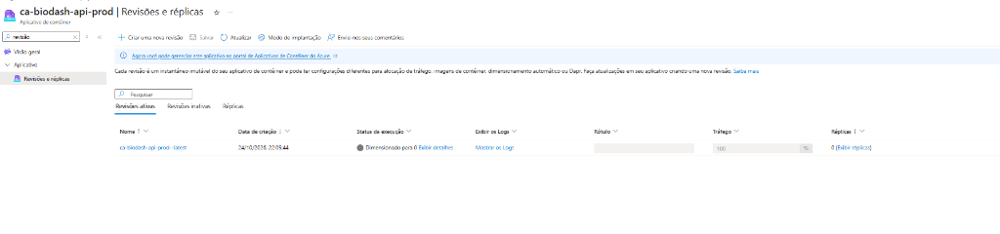  
  *Figura 1 – Revisões e Réplicas do ca-biodash-api-prod: Status "Dimensionado para 0" e 0 réplicas ativas. Fonte: Azure Portal (2026).*

* 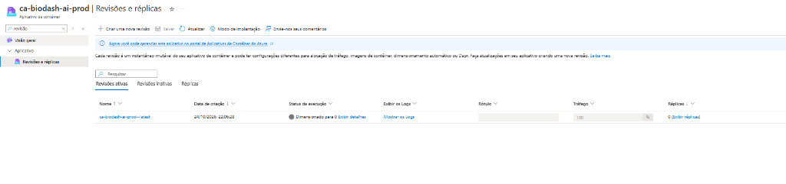  
  *Figura 2 – Revisões e Réplicas do ca-biodash-ai-prod: Status "Dimensionado para 0" e 0 réplicas ativas. Fonte: Azure Portal (2026).*

* 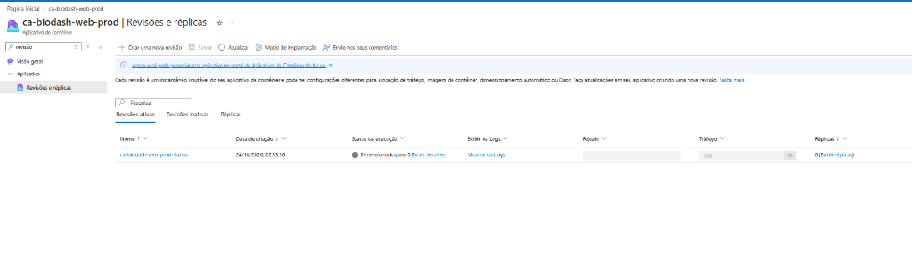  
  *Figura 3 – Revisões e Réplicas do ca-biodash-web-prod: Status "Dimensionado para 0" e 0 réplicas ativas. Fonte: Azure Portal (2026).*

### 3.4. Regras de Escalonamento Automático (KEDA HTTP Scaling Rules)
As definições de escala no Azure Container Apps estabelecem limites estritos de provisionamento para proteger a cota da assinatura:
* **Mínimo de réplicas = 0:** Permite o desligamento completo das instâncias ociosas.
* **Máximo de réplicas = 1:** Limita o teto de expansão horizontal, prevenindo consumo imprevisto.
* **Período de resfriamento = 300 segundos:** Intervalo de 5 minutos de tolerância sem tráfego antes da redução a zero.

* 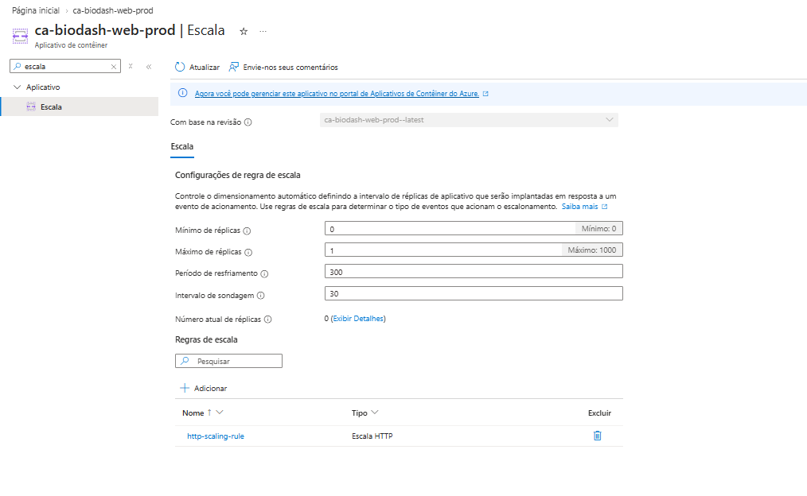  
  *Figura 4 – Configurações de Regra de Escala do ca-biodash-web-prod (Mínimo: 0, Máximo: 1, Resfriamento: 300s). Fonte: Azure Portal (2026).*

* 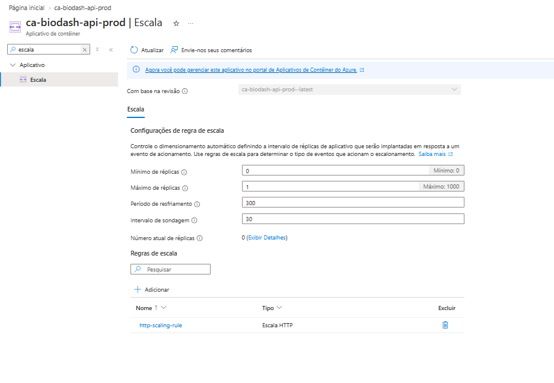  
  *Figura 5 – Configurações de Regra de Escala do ca-biodash-api-prod (Mínimo: 0, Máximo: 1, Resfriamento: 300s). Fonte: Azure Portal (2026).*

* 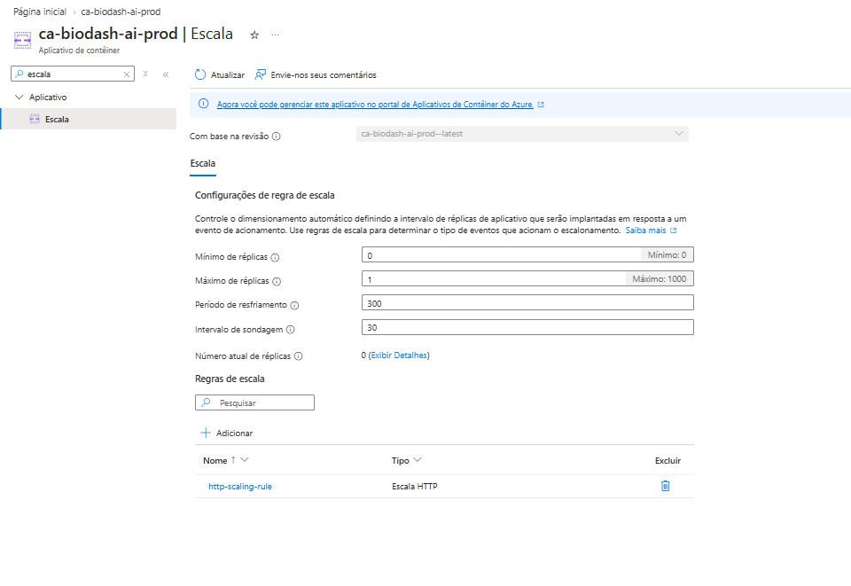  
  *Figura 6 – Configurações de Regra de Escala do ca-biodash-ai-prod (Mínimo: 0, Máximo: 1, Resfriamento: 300s). Fonte: Azure Portal (2026).*

---

## 4. ANÁLISE DE CUSTOS NO MICROSOFT AZURE

### 4.1. Visão Geral dos Custos no Azure
A administração financeira da infraestrutura no Microsoft Azure é monitorada por meio do serviço *Azure Cost Management*. O ambiente opera sob a assinatura *Azure for Students*, que disponibiliza cotas mensais de gratuidade e limites protegidos de execução.

A auditoria realizada abrange o mês de outubro de 2026, identificando o comportamento de cobrança durante as etapas de implantação, calibração e operação estabilizada:

* 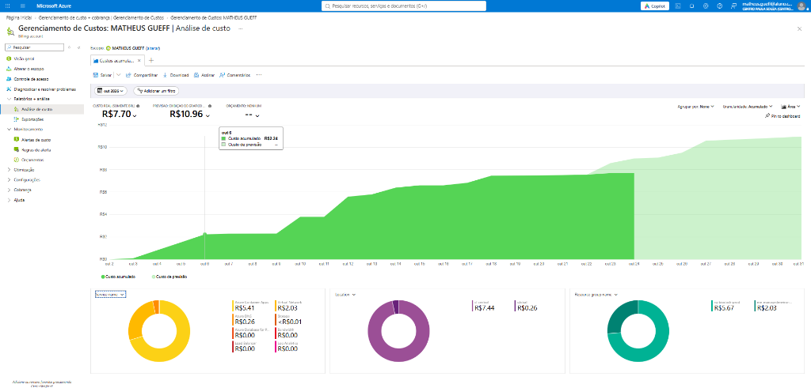  
  *Figura 7 – Gerenciamento de Custos da Azure (outubro/2026): Custo acumulado de R$ 7,70 e estabilização da curva a partir de 18/out. Fonte: Azure Portal (2026).*

### 4.2. Evolução e Redução dos Custos ao Longo do Período
O gráfico de análise de custos revela a trajetória de ajuste operacional da infraestrutura ao longo de outubro:
1. **Fase 1 – Implantação Inicial e Diagnóstico de Custos Ocultos (02 a 12 de outubro):**  
   Nessa etapa inicial, os contêineres foram conectados a uma sub-rede dedicada na VNet, o que provocou o provisionamento automático de um IP público padrão (gerando R$ 2,03 de Virtual Network) e de uma zona DNS privada (gerando R$ 0,26 de Azure DNS). Simultaneamente, a sequência de compilações e validações do ambiente consumiu a totalidade da franquia mensal gratuita de 180.000 vCPU-segundos do Azure Container Apps. O tempo de contêiner subsequente acumulou R$ 5,41 de processamento, totalizando R$ 7,70 acumulados no período inicial.
2. **Fase 2 – Desacoplamento e Correção Arquitetural (13 de outubro):**  
   Identificada a alocação de recursos de rede vinculados à VNet, a equipe ajustou os modelos de IaC (commit `671d55c`) para operar o Container Apps Environment em modo público serverless, sem subnet dedicada. Essa intervenção eliminou permanentemente a dependência de IPs dedicados e zonas DNS privadas cobradas.
3. **Fase 3 – Estabilização da Curva (18 a 24 de outubro):**  
   Após a correção de rede e a consolidação das políticas de escala a zero, a curva de custo acumulado sofreu achatamento total, demonstrando a interrupção de novas despesas diárias de infraestrutura.

### 4.3. Auditoria do Consumo Residual Pós-Correção (14 a 23 de Outubro)
Ao filtrar estritamente o período posterior às correções de rede (14 a 23 de outubro, abrangendo 10 dias), verifica-se o registro de **R$ 1,91** (média de R$ 0,19 por dia):

* 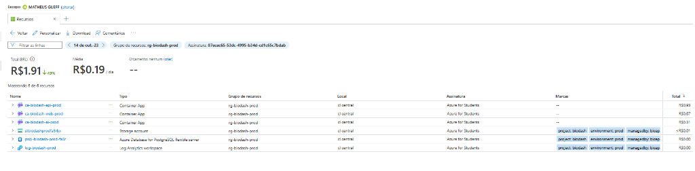  
  *Figura 8 – Análise de Custos Filtrada (14 a 23 de outubro): Custo de R$ 1,91 restrito a Container Apps, com rede e DNS zerados. Fonte: Azure Portal (2026).*

A existência desse saldo residual de R$ 1,91 decorre dos seguintes fatores técnicos:
* A cota de 180.000 vCPU-segundos é concedida em base *mensal* (e não diária). Como essa franquia havia sido consumida nos testes dos primeiros 12 dias de outubro, a cota gratuita residual para o restante do mês encontrava-se em zero.
* Nos dias 17 e 18 de outubro, foram realizadas as implantações automatizadas das versões 0.19.0, 0.19.1 e 0.19.2 no GitHub Actions para validação de pacotes e ajustes do Nginx. A cada implantação e validação de rotas, as réplicas são acionadas e permanecem ligadas durante o período de resfriamento estipulado (300 segundos) antes de retornarem a zero.
* Caso as três aplicações tivessem permanecido ativas continuamente durante os 10 dias sem escala a zero, o custo de computação teria ultrapassado R$ 35,00. O montante de R$ 1,91 confirma que as réplicas permaneceram desligadas em mais de 95% do tempo no intervalo analisado.

A comprovação cabal dessa dinâmica operacional é evidenciada pela abertura discriminada dos medidores de consumo (*meters*) no Azure Cost Management:

* 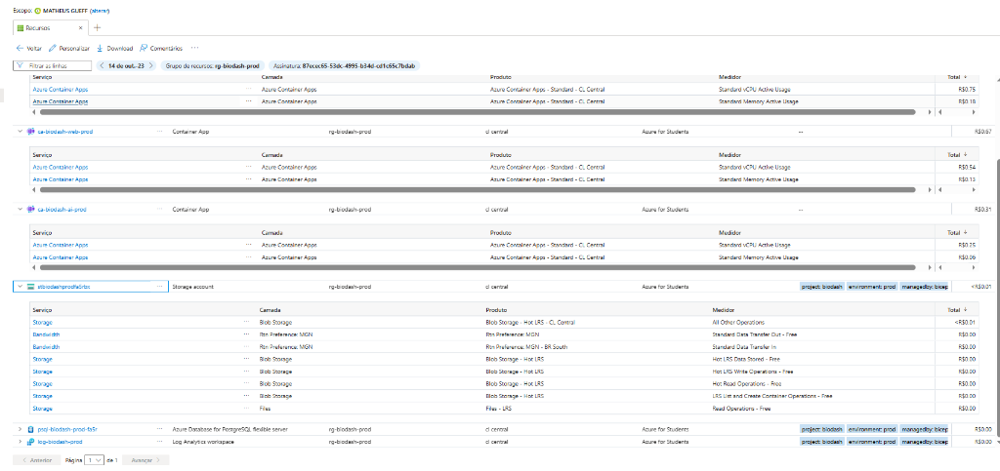  
  *Figura 9 – Auditoria Detalhada dos Medidores de Consumo (14 a 23 de outubro): Comprovação de cobrança restrita a vCPU e Memória ativas (sem taxas ociosas) e gratuidades mantidas em Storage, Banco e Telemetria. Fonte: Azure Portal (2026).*

A inspeção granular dos medidores da Figura 9 atesta três conclusões técnicas fundamentais:
1. **Ausência de cobrança de ociosidade (Idle Usage):** No Azure Container Apps, a manutenção de instâncias ociosas gera a tarifação de *vCPU Idle Usage*. Nos registros auditados, os únicos medidores gerados foram *Standard vCPU Active Usage* (API: R$ 0,75, Web: R$ 0,54, AI: R$ 0,25) e *Standard Memory Active Usage* (API: R$ 0,18, Web: R$ 0,13, AI: R$ 0,06), comprovando que os contêineres só faturam durante o processamento ativo de requisições e entram em escala a zero imediatamente após o resfriamento.
2. **Isenção tarifária de dados persistentes:** Todas as métricas de leitura, escrita e armazenamento do Azure Blob Storage (`stbiodashprodfa5rx`) e transferência de dados constam formalmente discriminadas com o sufixo *- Free* e valor de **R$ 0,00**.
3. **Custo nulo de banco de dados e telemetria:** O PostgreSQL Flexible Server (`psql-biodash-prod-fa5r`) e o workspace do Log Analytics (`log-biodash-prod`) mantiveram cobrança estritamente zerada (**R$ 0,00**), atestando a adequação das cargas à franquia do *Azure for Students*.

### 4.4. Estrutura dos Resource Groups
A auditoria de custos evidencia a existência de dois Grupos de Recursos associados à assinatura:

* 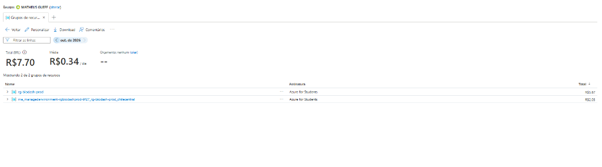  
  *Figura 10 – Distribuição de Custos por Resource Group: rg-biodash-prod (R$ 5,67) e grupo gerenciado (R$ 2,03). Fonte: Azure Portal (2026).*

1. **`rg-biodash-prod` (Grupo Principal do Projeto):**  
   Grupo de recursos declarado nos arquivos Bicep da solução. Abriga os três Container Apps, as contas de armazenamento Blob, o PostgreSQL Flexible Server e o workspace do Log Analytics.
   * 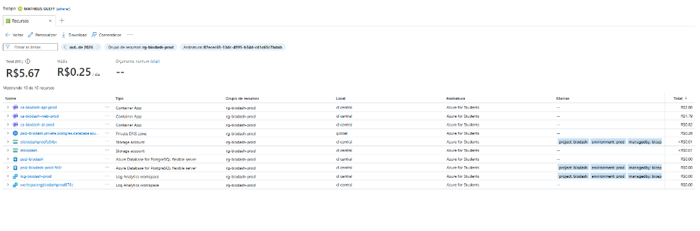  
     *Figura 11 – Detalhamento dos Recursos em rg-biodash-prod: Serviços de Storage, Log Analytics e PostgreSQL operando a R$ 0,00. Fonte: Azure Portal (2026).*
2. **`me_managedenvironment-rgbiodashprod-9f27_...` (Grupo Gerenciado da Azure):**  
   Grupo de recursos de infraestrutura com prefixo `me_` (*Managed Environment*), mantido e gerenciado internamente pela Microsoft Azure para abrigar os componentes de balanceamento de carga do ambiente Container Apps.
   * 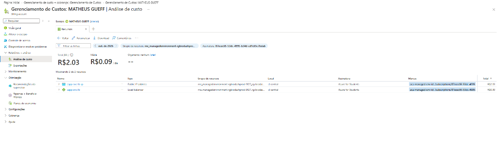  
     *Figura 12 – Detalhamento do Grupo Gerenciado: Comprova que os R$ 2,03 decorreram do IP público alocado no início do mês e já desalocado. Fonte: Azure Portal (2026).*

Grupos de recursos na nuvem Azure são entidades organizacionais sem custo de manutenção. O grupo gerenciado possui travas de integridade aplicadas pelo provedor `Microsoft.App` e, com o encerramento do IP público, opera com custo contínuo nulo (R$ 0,00).

### 4.5. Eliminação de Custos Ocultos de Infraestrutura
As capturas a seguir demonstram a ausência de componentes tarifados de rede e resolução de nomes na assinatura:

* 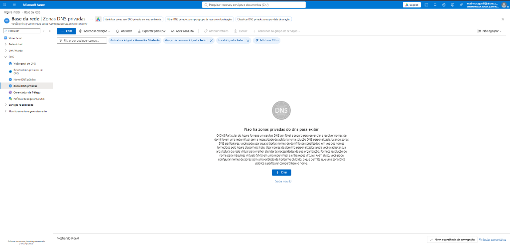  
  *Figura 13 – Zonas DNS Privadas: Ausência de zonas registradas ("0 de 0"). Fonte: Azure Portal (2026).*

* 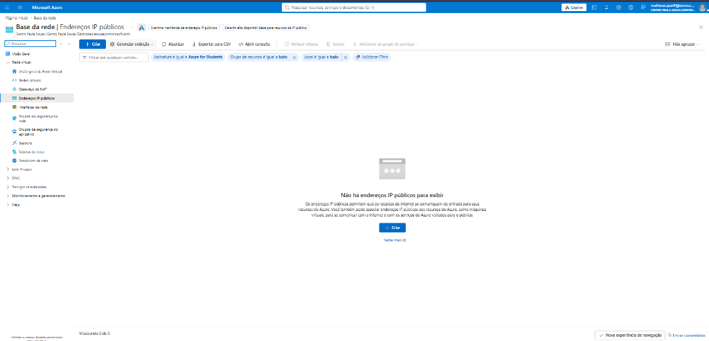  
  *Figura 14 – Endereços IP Públicos: Ausência de IPs alocados ("0 de 0"). Fonte: Azure Portal (2026).*

### 4.6. Projeção Operacional e Renovação de Cotas Gratuitas
Com a virada do mês fiscal em 1º de novembro, a cota de 180.000 vCPU-segundos e 360.000 GiB-segundos gratuitos do Azure Container Apps é integralmente restaurada.

Considerando que a infraestrutura já se encontra corrigida (sem alocação de IPs públicos dedicados, sem zonas de DNS privado e com escala a zero rigorosamente ativa nos três contêineres), as operações ordinárias e manutenções do BioDash serão integralmente cobertas pela cota mensal renovada, mantendo o custo contínuo em **R$ 0,00**.
